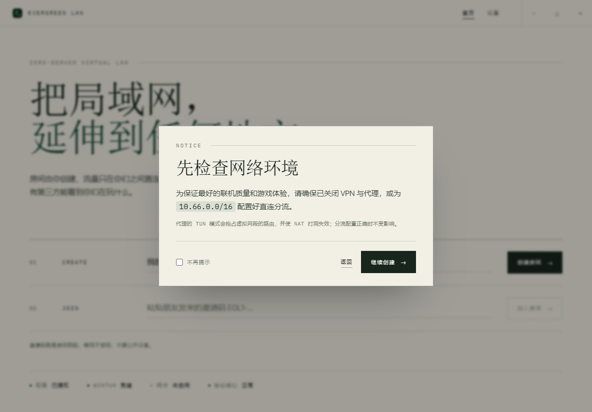
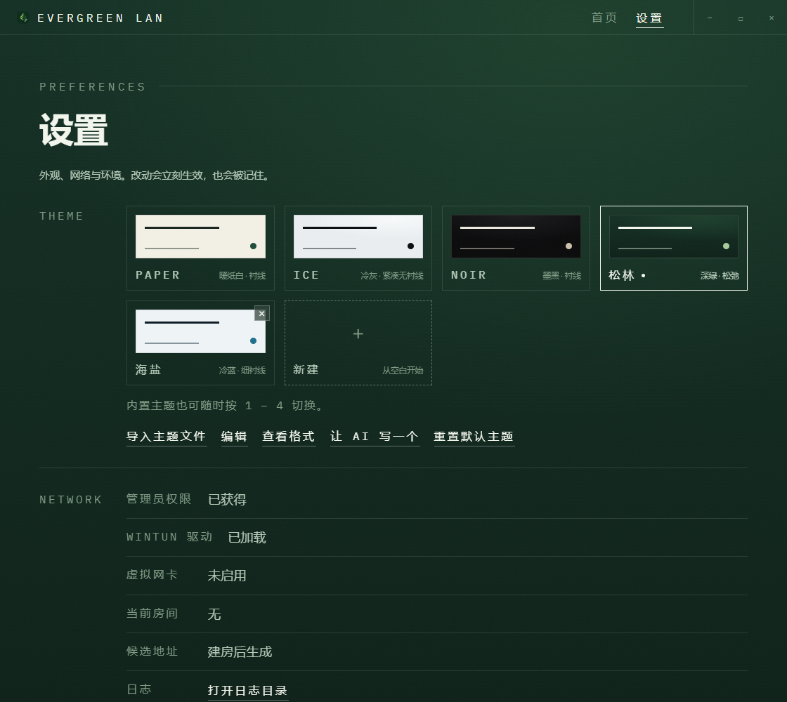
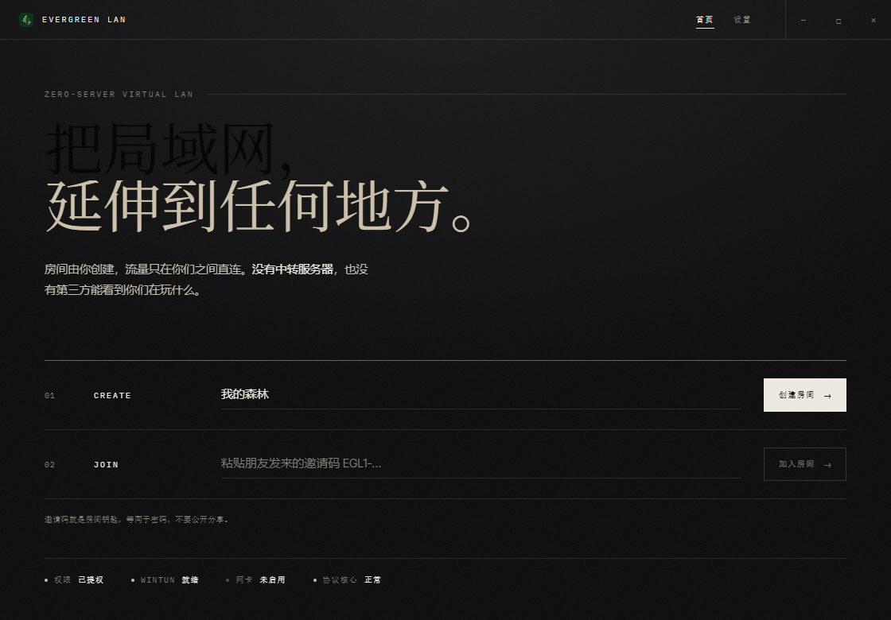
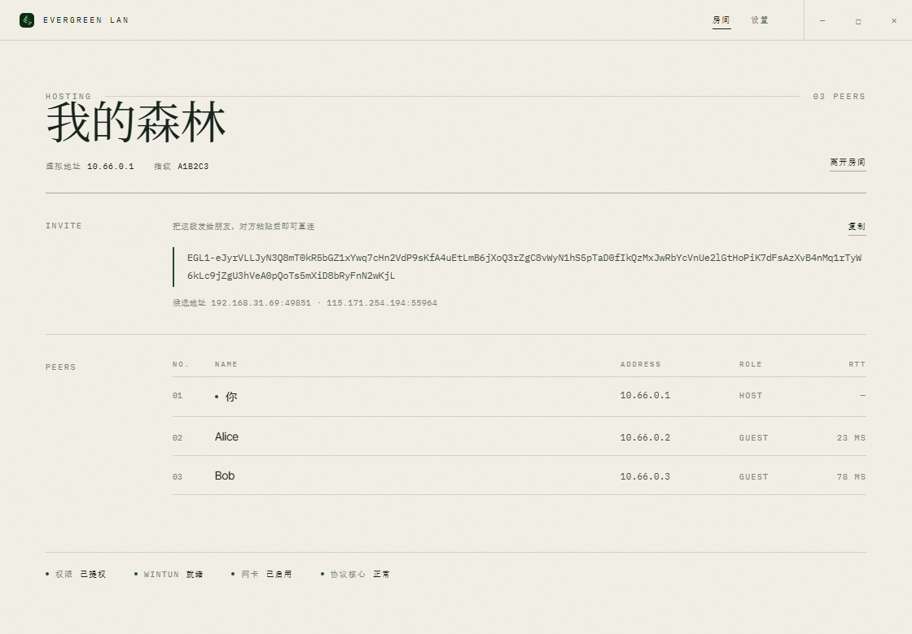
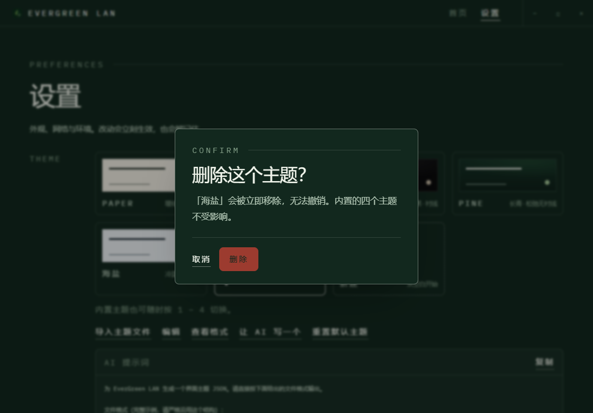
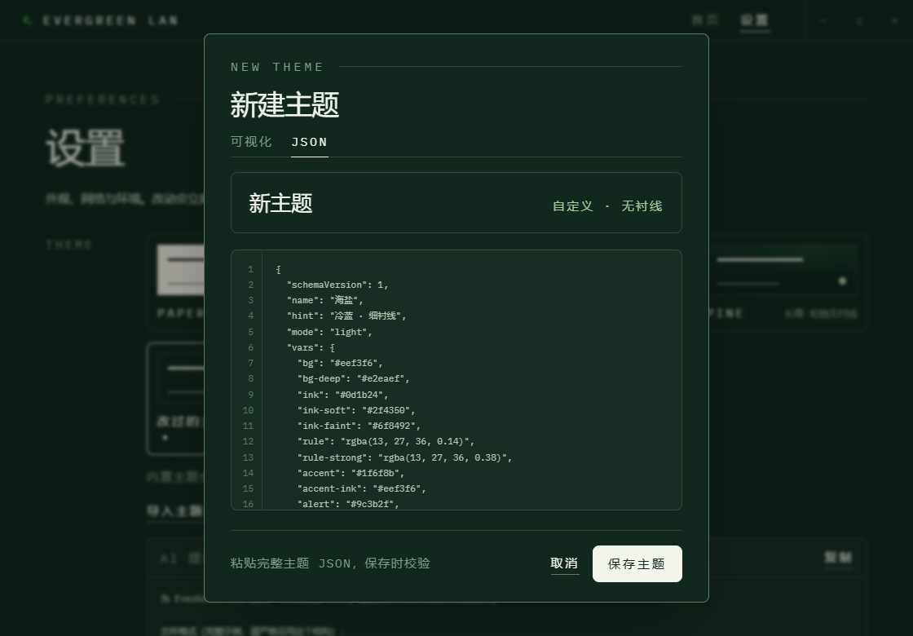

# EverGreen LAN

> 把局域网延伸到任何地方。零服务器的虚拟局域网，为 Minecraft 而生。

EverGreen LAN 让身处不同网络的玩家像坐在同一个交换机下一样联机：Minecraft 的「对局域网开放」会自动出现在
对方的多人游戏列表里，不需要记 IP，不需要端口映射，也不经过任何中转服务器。

**数据面纯点对点**：你和对端之间是直连的加密 UDP，没有任何第三方能看到或转发你们的游戏流量。


---

## 目录

- [这是什么](#这是什么)
- [现在能跑什么](#现在能跑什么)
- [安装](#安装)
- [使用](#使用)
- [界面与主题](#界面与主题)
- [工作原理](#工作原理)
- [为什么没有「房间号」](#为什么没有房间号)
- [兼容性](#兼容性)
- [从源码构建](#从源码构建)
- [测试与验证](#测试与验证)
- [安全与信任](#安全与信任)
- [常见问题](#常见问题)
- [路线图](#路线图)
- [许可](#许可)

---

## 这是什么

一个桌面程序，做三件事：

1. 在你的机器上创建一张**虚拟网卡**（Windows 用 Wintun，macOS 用 utun，Linux 用 `/dev/net/tun`），
   给它一个 `10.66.0.0/16` 里的地址
2. 把这张网卡上的流量**加密后点对点**发给房间里的其他机器
3. 让「局域网广播」在虚拟网络里也能正常工作，于是 Minecraft 会自动看见房间

没有账号，没有服务器，没有云端配置。房间由某个人创建，连接信息装在一段**邀请码**里，由用户自己发给朋友。

## 支持的平台

| 平台 | 虚拟网卡 | 提权方式 | 状态 |
|---|---|---|---|
| Windows 10 / 11 | Wintun | UAC，应用内可重启发起重启 | ✅ 已实机验证 |
| macOS 11+ | `utun` | 应用内授权框（无需终端） | 🧪 utun 已实机建立，联机待验证 |
| Linux x86_64 / arm64 | `/dev/net/tun` | polkit 授权框（`pkexec`） | 🧪 已交叉编译，**未实机验证** |

macOS 与 Linux 的代码路径已通过 `cargo check --target` 交叉编译，命令构造也有单元测试，
但还没有在真机上跑过联机。第一次在 Mac 上试时请留意日志里的失败原因。

## 现在能跑什么

| 能力 | 状态 |
|---|---|
| 协议核心：邀请码、Noise 握手、STUN、打洞、路由决策 | ✅ 59 个测试，含真实 UDP 双端握手 |
| 房间运行时：网卡 ↔ 隧道 ↔ 路由 | ✅ 15 个集成测试：单播、广播复制、访客互通、越界丢弃 |
| 虚拟网卡与网段路由 | ✅ **已实机验证**：网卡 Up、`10.66.0.1/16`、`224.0.2.60/32`、MTU 1200 |
| 桌面界面（Tauri 2 + React） | ✅ 设置页 + 四套主题，10 项 UI 冒烟测试 |
| 安装包（NSIS，按用户安装） | ✅ 1.94 MB，含驱动，实测安装 / 启动 / 卸载 |
| **两台机器端到端联机** | ⏳ 需要第二台机器 |
| **Minecraft 里真的看到房间** | ⏳ 依赖上一条 |
| UPnP 端口映射、开机自启、代码签名 | ⏳ 未做 |

## 安装

```powershell
target\release\bundle\nsis\EverGreen LAN_0.1.0_x64-setup.exe
```

- 装到 `%LOCALAPPDATA%\EverGreen LAN`，**安装本身不需要管理员权限**
- 包内含 `wintun.dll`、`LICENSE`、`NOTICE`、`THIRD-PARTY-NOTICES.md`
- 卸载走同目录的 `uninstall.exe` 或系统「应用和功能」

> ⚠️ 当前安装包**没有代码签名**，Windows SmartScreen 会提示「未知发布者」。见[安全与信任](#安全与信任)。

## 使用

**建房的人：**

1. 右键程序 → 以管理员身份运行（创建虚拟网卡必需），或点界面上的「以管理员身份重启 →
2. 输入房间名，点「创建房间」
3. 复制页面上那串 `EGL1-…` 邀请码，发给朋友

**加入的人：**

1. 同样以管理员身份启动
2. 把邀请码粘进「加入房间」，回车

连上后，双方在 Minecraft 里点「对局域网开放」，对方的多人游戏列表里就会自动出现这个房间。

创建房间前会先提示一次网络环境，可用「不再提示」永久关闭：



## 界面与主题

编辑式排版：大字号标题、细线网格、等宽小标签，没有圆角卡片和发光阴影。动效克制——标题逐行升起、
输入框下划线从左展开、成员逐条淡入，全部统一在一条缓动曲线 `cubic-bezier(.22,1,.36,1)` 上，并尊重
系统的「减少动态效果」。

主题收在**设置页**里，四选一，选中即生效并记住（也可按 `1`–`4`）：



| Paper | Ice |
|---|---|
|  |  |
| 暖纸白 + 深林绿，衬线标题，印刷质感 | 冷灰蓝 + 纯黑，紧凑无衬线，包豪斯式留白 |

| Noir | Pine |
|---|---|
|  |  |
| 墨黑 + 衬线，电影颗粒，最沉的一档 | 深林绿 + 嫩叶强调色，松弛无衬线，留白更宽（默认）|

房间页：



字体随包分发（Instrument Serif / Inter Tight / IBM Plex Mono，OFL 授权，共 159 KB），
中文按主题自动匹配衬线或黑体。应用图标是等距像素风的常青松，右下角挂一枚双环链接——树是 Evergreen，
环是 LAN。顶栏直接用同一张图，任务栏、安装包、窗口标题栏三处一致。

### 自定义主题

四个内置主题之外，用户可以在设置页点「导入主题文件…」，用系统文件选择框挑一份 JSON，
主题立刻出现在网格里并被选中。格式说明与 AI 提示词就在同一页展开，不需要去翻目录找示例文件；
导入的主题与偏好一起保存在本机。


主题文件带 `schemaVersion`，并用 `mode: light | dark` 声明明暗，决定 `color-scheme`。
**强调色会自动做对比度修正**：渲染时计算强调色与底色的对比度，低于 4.5:1 就逐步调亮或调暗，
因此浅底浅色也不会出现看不清的字。

导入失败不会静默——设置页直接显示原因（哪个字段、错在哪），同时记入日志。

不想碰文件也行：网格末尾的虚线卡「新建」打开空白编辑器，「编辑」直接覆盖当前主题
（内置的四个也能改，覆盖值单独存放，随时可重置回源文件）。
颜色、标题字体、小字字体、字重、圆角与字号都可调，实时预览后保存。
同一个弹窗还能切到「JSON」分页，直接粘贴整份主题文件。


删除与重置都有确认弹窗——「重置默认主题」会清空全部自定义主题，回到默认的 Pine。





格式、可用变量与限制见 [docs/theme-authoring.md](docs/theme-authoring.md)。

## 工作原理

### 三层结构

```
┌──────────── Tauri 2 + React（界面）────────────┐
│  房间 / 成员 / 延迟 / 设置                      │
└───────────────────┬───────────────────────────┘
                    │ Tauri IPC
┌───────────────────▼──── Rust 核心 ────────────┐
│ ① 信令  邀请码（zlib + bincode + base64url）     │
│ ② 认证  Noise_IKpsk0（房间密钥 + 静态身份）      │
│ ③ 传输  加密 UDP 帧，1200 字节 MTU              │
│ ④ 穿透  STUN 发现 + 多候选并发打洞               │
│ ⑤ 网络  Wintun 虚拟网卡 + 10.66.0.0/16         │
│ ⑥ 路由  单播定向 / 组播与广播复制                │
└────────────────────────────────────────────────┘
```

代码分成五个 crate：

```
crates/evergreen-lan-core   协议核心：邀请码、Noise、STUN、隧道、IP 分类、路由决策（与 OS 无关）
crates/evergreen-lan-tun    Wintun 封装
crates/evergreen-lan-route  netsh 地址 / 路由 / 防火墙
crates/evergreen-lan-room   运行时：把上面三个与 UDP socket 串成一条数据通路
apps/desktop                Tauri 应用（React 前端 + Rust 命令层）
```

可执行文件名为 `evergreen-lan.exe`，安装包名为 `EverGreen LAN_<版本>_x64-setup.exe`。

### 邀请码

```
EGL1-<base64url(zlib(bincode(InviteCode)))>
```

约 200–260 字符，包含：房间 ID、房间密钥、主机静态公钥、主机虚拟地址、候选 `ip:port` 列表、创建时间。

解码时校验版本、字段长度、候选地址必须是字面量 `ip:port`（**拒绝域名**，邀请码必须离线可用）、
解压上限 8 KiB（防解压炸弹）。

**候选地址必须真的可达。** 我们枚举所有网卡并过滤掉：回环、链路本地（`169.254`）、我们自己的虚拟网卡
（`10.66/16`）、以及 `198.18.0.0/15`——后者是代理软件（Clash 等）的假 IP 网段，发给朋友等于给了一个
只在本机存在的地址。

### 握手：Noise_IKpsk0

完整算法名是 `Noise_IKpsk0_25519_ChaChaPoly_BLAKE2s`，拆开是三层：

| 层 | 是什么 | 在我们的用途 |
|---|---|---|
| **X25519** | Curve25519 上的 ECDH 密钥交换 | 长期身份密钥 + 每次会话的临时密钥（前向保密） |
| **ChaCha20-Poly1305** | AEAD 密码 | 每条 UDP 数据报独立加密 + 认证（16 字节标签） |
| **Noise IK + psk0** | 握手模式 | 一次往返建立会话 |

拆开两个修饰符：

- **IK**：发起方（访客）**事先知道**响应方（主机）的静态公钥 → 只要 1 个往返
- **psk0**：预共享密钥在**第一条消息之前**混入 → 没有邀请码的包在第一条就被丢弃，**连 DH 运算都不做**

握手本身只有两条消息：

```
访客                                    主机
 │  → e, es, s, ss        (96 字节)      │
 │  ← e, ee, se           (48 字节)      │
 │  【双方进入加密传输】                   │
```

这解决了四件事：访客确认主机身份（防中间人）、主机确认访客有邀请码、每次会话有临时密钥、
房间 ID 作为 prologue 绑进握手（不同房间无法串话）。

> WireGuard 用的是同族的 `IKpsk2`；我们选 `psk0` 是为了让主机在付出计算代价之前就能拒绝陌生包。

### 拓扑：星形，但像交换机

房间是**星形**：每个访客只与主机建立一条隧道，访客之间没有直接会话。

| | 全互联（mesh） | 星形（当前） |
|---|---|---|
| 握手次数 | N²，每对都要独立打洞 | N |
| 对打洞的要求 | 每一对都必须成功 | 只有主机需要可被连接 |
| 主机带宽 | 只承载自己的流量 | 承载所有访客互访流量 |

因为只有主机需要「好打洞」的 NAT，星形显著提高了成功率。为了让星形用起来像交换机，主机做两件事：

1. **中继广播**：访客 A 的 `224.0.2.60` 公告，主机本地注入后还会转发给其余访客，且**不回传给发送者**
2. **路由单播**：访客 A 发给访客 B 的包，主机按目的虚拟 IP 转发

访客侧实现**网关语义**：目的地是虚拟网段内、但本地没有对应会话时，一律交给主机。

### Minecraft 局域网发现

Minecraft Java 的「对局域网开放」会周期性向 `224.0.2.60:4445` 发送：

```
[MOTD]玩家名 - 世界名[/MOTD][AD]端口[/AD]
```

要让这个包跨过互联网，需要三件事：

1. **路由**：把 `224.0.2.60/32` 指向虚拟网卡（`10.66.0.0/16` 的定向广播由地址分配自动产生）
2. **复制**：识别为组播/广播后，复制给房间内每个对端
3. **注入**：对端写进自己的虚拟网卡，本机 Minecraft 就像收到局域网广播

这套逻辑是**通用的**：任何用组播或定向广播发现局域网游戏的程序都因此受益，不需要为每个游戏写适配。

### 端口

主机固定监听 **UDP 39271**（被占用时才退回随机端口，并在日志里说明）。固定端口带来两个好处：

- 邀请码在主机重启后依然有效——随机端口会让旧邀请码「看起来正常但永远连不上」
- 路由器上做端口映射时目标端口是确定的

访客端仍使用随机源端口，不需要任何配置。

### NAT 穿透与 STUN

STUN 解决的问题是：「我在外面看起来长什么样？」

你家网络里的电脑是 `192.168.1.23`，出路由器时被 NAT 改写成一个公网 `IP:端口`，而**你自己看不到改写的
结果**。STUN 就是找一台外面的服务器问一句「你看到我是从哪来的」。

请求只有 20 字节：

```
[0..2]  0x0001         Binding Request
[2..4]  0x0000         无属性
[4..8]  0x2112A442     魔术字
[8..20] 12 字节随机数   事务 ID
```

服务器回 `XOR-MAPPED-ADDRESS`，就是你的公网端点。实测这台机器返回的是：

```
candidates = ["192.168.1.23:54748", "114.514.191.981:55964"]
              ↑ 局域网地址              ↑ STUN 得到的公网映射（示例值，不是合法 IPv4）
```

注意两个端口不同——这就是 NAT 改写的证据，也是为什么「查 IP」不够、必须查**端点**。

拿到候选后，客户端**同时**向所有候选发包（每 300 ms 一轮，最多 10 轮），第一台回应的就是可用路径。

**只用 STUN，不用 TURN。** 没有中转服务器，这是项目的硬约束。代价是某些网络下打洞会失败——那时会明确
告诉你连不上，而不是偷偷走中转。

| | 作用 | 流量经过它吗 |
|---|---|---|
| STUN | 告诉你自己的公网端点 | ❌ 只交换地址 |
| TURN | 中转，两边连不上时帮忙转发 | ✅ 全部流量 |
| ICE | 框架，组合上面两种并挑最优路径 | 取决于路径 |

## 为什么没有「房间号」

Radmin VPN 那类产品能靠「网络名 + 密码」加入，是因为背后有一台厂商的协调服务器负责认人和交换地址——
只是流量走 P2P 而已。真正零服务器，就必须把连接信息装进一段**邀请码**里，由你自己发出去。

这里的取舍是刻意的：**没有服务器，所以没有房间号；没有房间号，所以没有单点。**

## 兼容性

| 档位 | 机制 | 代表游戏 |
|---|---|---|
| ① 输入 IP | 游戏只认手动填写地址 | 泰拉瑞亚、幻兽帕鲁、方舟、七日杀 |
| ② 组播/定向广播 | 发送发现包，自动出现在列表 | Minecraft、星露谷、饥荒、CS1.6、魔兽争霸3 |
| ③ 受限广播 | 发往 `255.255.255.255`，需内核层拦截 | 暂不支持（如红色警戒 2） |

档位 ② 是一套通用的 L3 能力，不需要为每个游戏单独适配。

## 从源码构建

**Windows**

```powershell
npm install
pwsh -File scripts\fetch-wintun.ps1 -CopyToTarget   # 第三方驱动，不随仓库分发
npm run desktop                                     # 开发模式
npx tauri build                                     # 出 NSIS 安装包
```

**macOS / Linux**

```bash
npm install
npm run desktop        # 开发模式
npx tauri build        # macOS 出 .app + .dmg，Linux 出 .deb + .AppImage
```

macOS 与 Linux 不需要 Wintun，打包时也不会带上 `wintun.dll`——
资源清单放在 `tauri.windows.conf.json`，其余平台读各自的配置。

运行需要 root：macOS 用 `sudo` 启动（打包后是
`sudo "/Applications/EverGreen LAN.app/Contents/MacOS/evergreen-lan"`），
Linux 用 `sudo` 或带 `cap_net_admin` 的包装。

需要：Rust 1.77+（MSVC 工具链）、Node 22+、WebView2（Win11 自带）。

## 测试与验证

```powershell
cargo test -p evergreen-lan-core -p evergreen-lan-tun -p evergreen-lan-route -p evergreen-lan-room -p evergreen-lan --lib   # 92 个
npx vite preview --port 4173 --outDir apps/desktop/dist
node scripts/ui-check.mjs                                          # 18 项 UI 冒烟
```

| 套件 | 数量 | 覆盖什么 |
|---|---|---|
| `evergreen-lan-core` | 59 | 邀请码往返/篡改、IPv4 分类、STUN 报文、Noise 握手、**真实 UDP 双端互通**、路由决策 |
| `evergreen-lan-room` | 15 | 单播、广播复制、访客互通、越界丢弃、地址分配、错误邀请码 |
| `evergreen-lan-route` | 8 | netsh 命令构造、含空格路径的引号处理、幂等性 |
| `evergreen-lan` | 8 | 主题文件校验：版本号、颜色格式、必需字段、BOM、危险值 |
| `evergreen-lan-tun` | 2 | 驱动探测 |
| UI（Playwright） | 18 | 导航、主题切换与持久化、自定义主题应用、快捷键、代理提示弹窗 |

**已实机验证**（提权跑真网卡）：

| 检查项 | 结果 |
|---|---|
| `Get-NetAdapter EverGreen LAN` | Up，描述 `EverGreen Tunnel` |
| IPv4 地址 | `10.66.0.1/16` |
| `224.0.2.60/32` 路由 | 存在，metric 1 |
| MTU | 1200 |
| `Find-NetRoute 224.0.2.60` | **走 EverGreen LAN** |

### 在没有界面的机器上验证网卡

`host_probe` 是仓库自带的一个诊断程序。它走的是和图形界面**完全相同的 `Room::host()`**，只是没有界面，
把结果写进日志——用于 CI、服务器、远程桌面这类没有图形环境的地方确认驱动与路由是否正常。

```powershell
cargo build -p evergreen-lan-room --bin host_probe
Start-Process .\target\debug\host_probe.exe -Verb RunAs -ArgumentList "$PWD\artifacts\probe.log"
```

成功时日志里是：

```
OK adapter created
virtual_ip=10.66.0.1
udp_port=49851
candidates=["192.168.1.23:49851", "114.514.191.981:55964"]
```

程序会保持网卡 12 秒再干净退出，方便你在另一个窗口核对：

```powershell
Get-NetAdapter -Name 'EverGreen LAN'
Get-NetIPAddress -InterfaceAlias 'EverGreen LAN'
Get-NetRoute -InterfaceAlias 'EverGreen LAN'
```

## 安全与信任

### 信任分层

466 个依赖摆在仓库里，但**能碰到密钥的只有 14 个**：

| 层级 | 组件 | 数量 | 接触密钥 |
|---|---|---|---|
| 1 | 本程序本身（管理员 + 网络驱动） | — | 是 |
| 2 | `wintun.dll` | 1 个二进制 | 否，但接触网络栈 |
| 3 | 密码学 crate | **14** | **是** |
| 4 | Tauri / GUI 依赖 | ~400 | 否 |
| 5 | 字体、图标 | 4 个文件 | 否 |

第三层是 `snow · curve25519-dalek · chacha20poly1305 · poly1305 · chacha20 · sha2 · blake2 · aead ·
subtle · zeroize · getrandom · rand_core`，全部来自 RustCrypto 与 snow 项目。

### 网络行为清单（可核查）

我们自己的代码里，**全部**外部网络目的地只有三个公共 STUN 服务器：

```
stun.l.google.com:19302 · stun1.l.google.com:19302 · stun.cloudflare.com:3478
```

- 前端 **0 处** `fetch` / `XMLHttpRequest` / `WebSocket`
- 全仓库 **0 处** 遥测、统计、崩溃上报关键字
- 没有账号、没有登录、没有云端配置、没有自动更新检查

```powershell
Select-String -Path crates\*\src\*.rs -Pattern 'https?://'
Select-String -Path apps\desktop\src\*.ts* -Pattern 'fetch\(|https?://'
```

STUN 只交换一个 IP 和端口，不接触任何流量。清空 `RoomConfig::stun_servers` 即可完全离线（此时只能
和同一局域网的朋友联机）。

### 供应链

| 机制 | 现状 |
|---|---|
| 版本锁定 | `Cargo.lock` 固定 **466** 个 crate 的精确版本；`package-lock.json` 固定 npm 树 |
| 完整性校验 | **461 / 466** 带 SHA-256 校验和（剩下 5 个是我们自己的本地 crate） |
| 运行时依赖 | 约 **259** 个（其余是构建期工具、过程宏、其他平台的条件依赖） |
| 许可 | 全部宽松/弱 copyleft，**无 GPL/AGPL**；唯一的 MPL-2.0 是 Tauri 的 CSS 解析工具链（5 个，文件级 copyleft，未修改） |
| 二进制来源 | 只有一个 `wintun.dll`，来自 WireGuard LLC，有数字签名 |
| 字体 | 三套 OFL 字体，全文随包 |

完整清单见 [`THIRD-PARTY-NOTICES.md`](THIRD-PARTY-NOTICES.md)（由 `scripts/third-party-notices.py`
生成，依赖一变重跑即可）。`deny.toml` 里放好了 `cargo-deny` 策略：GPL 不在白名单、禁通配符版本、
禁 sentry 这类遥测 SDK。

### 已知缺口（如实列出）

| 缺口 | 影响 | 计划 |
|---|---|---|
| **发布包无代码签名** | SmartScreen 提示「未知发布者」，这会实质影响用户信任 | SignPath（开源免费）/ Azure Trusted Signing / OV-­EV 证书 |
| **macOS / Linux 网卡未实机验证** | 两个平台的 utun / tun 代码只做过交叉编译与命令单测，真实联机未跑通 | 在真机上跑一次建房 |
| **防火墙规则尚未实机验证** | 规则创建失败时朋友连不上；失败会在房间页与日志中显式提示 | 下次提权建房时核对 `Get-NetFirewallRule` |
| CSP 为 `null` | WebView 不限制来源 | 只加载本地资源，风险低，但该收紧 |
| `cargo-deny` 未接入 CI | 依赖漏洞不会自动发现 | 仓库还没有 CI，需先建 |
| 构建非字节级可复现 | 用户无法用哈希证明二进制对应这份源码 | 固定时间戳/路径 + `--remap-path-prefix` |
| 无 SBOM 产物 | 企业资产清点不便 | 可由 `Cargo.lock` 生成 CycloneDX |
| 身份密钥明文落盘 | 本机被入侵时可读 | 迁移到 Windows 凭据管理器 |

### 怎样完全不信任我们

```powershell
cargo build --release -p evergreen-lan
```

运行你自己编译的 exe。唯一的预编译件是 Wintun，可自行从 wintun.net 下载并核对签名。
运行时用 Wireshark 抓包核对：除了 STUN 与邀请码对应的对端地址，不应出现任何其他 UDP 目的地。

### 报告漏洞

见 [`SECURITY.md`](SECURITY.md)。请私下报告，不要开公开 issue。

## 日志

程序是 GUI 子系统，控制台输出会被丢弃，因此日志写入文件：

```
%LOCALAPPDATA%\EverGreenLAN\logs\evergreen-lan.log
```

超过 2 MiB 时轮转为 `evergreen-lan.log.1`。设置页的「打开日志目录」可以直接定位。
报问题之前先看一眼这里——握手失败、`netsh` 失败、对端超时都会记录。

日志级别可用环境变量 `EVERGREEN_LAN_LOG` 调整，例如 `EVERGREEN_LAN_LOG=debug`。

## 常见问题

**创建房间报「需要管理员权限」**
创建虚拟网卡必须提权。点界面上的「以管理员身份重启 →」，或右键程序选择以管理员身份运行。

**加入了但连不上**
先看房间页的「候选地址」：如果只有 `192.168.x.x`，说明 STUN 没成功（被代理或防火墙挡住），
异地朋友连不上。关掉代理软件的全局/TUN 模式再试。

**开着 Clash / v2ray 能用吗**
代理的 TUN 模式会抢走 `10.66.0.0/16` 的路由并让打洞失效。联机时请为 `10.66.0.0/16` 配直连，
或直接退出代理。

**Minecraft 里看不到房间**
确认两台机器都能 ping 通对方的虚拟 IP。能 ping 通但看不到，通常是防火墙挡了 UDP 4445。

**为什么两个端口的数字不一样**
本地 socket 的端口和 NAT 改写后的公网端口本来就不同，这是正常的。

**支持 IPv6 吗**
目前只做 IPv4 覆盖网络。

## 路线图

| 阶段 | 内容 | 状态 |
|---|---|---|
| P0 | 工程骨架、界面、四套主题 | ✅ |
| P1 | 邀请码、IP 分类、STUN | ✅ |
| P2 | Noise 隧道 + 打洞 | ✅ |
| P3 | 房间运行时 + 星形中继 | ✅ |
| P4 | Wintun 网卡与网段路由（实机验证） | ✅ |
| P5 | NSIS 安装包 | ✅ |
| P6 | 两台机器端到端联机 + MC 实测 | ⏳ |
| P7 | UPnP 端口映射（对称 NAT 兜底） | ⏳ |
| P8 | 代码签名、CSP 收紧、CI | ⏳ |

## 许可

**Apache License 2.0** —— 见 [`LICENSE`](LICENSE)。

选它而不是 MIT，主要是那句**明示的专利授权**：网络与加密相关的项目，贡献者不小心带上专利风险的可能性
不为零，Apache-2.0 让每个贡献者自动授予使用者专利许可。代价是文本长一些、需要保留版权与 NOTICE。

第三方组件保持各自许可，不随本项目的 Apache-2.0 授权：

| 组件 | 许可 |
|---|---|
| `wintun.dll`（WireGuard LLC） | Prebuilt Binaries License，随安装包分发 |
| Instrument Serif / Inter Tight / IBM Plex Mono | SIL Open Font License 1.1 |
| Rust 与 npm 依赖 | 各自许可，见 `THIRD-PARTY-NOTICES.md` |

## 更多文档

- [`docs/architecture.md`](docs/architecture.md) —— 设计决策的完整记录（含踩过的坑）
- [`SECURITY.md`](SECURITY.md) —— 漏洞报告渠道
- [`THIRD-PARTY-NOTICES.md`](THIRD-PARTY-NOTICES.md) —— 依赖许可清单

## 赞助

如果这个项目帮到了你，可以在爱发电支持一下：<https://ifdian.net/a/aliu-Bruce>

应用内也留了同一个入口：**设置 → Support → 赞助作者**。
